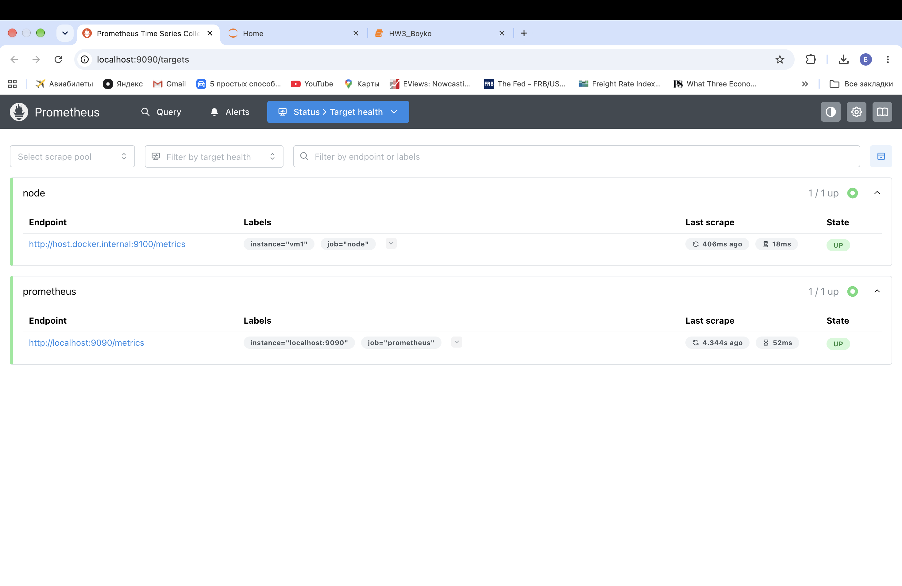
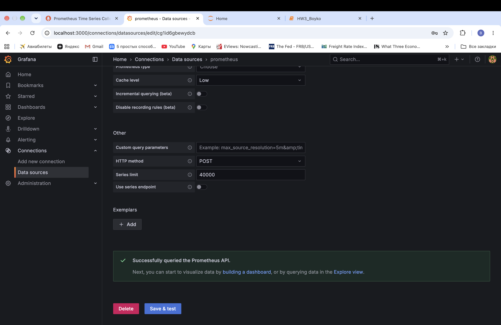
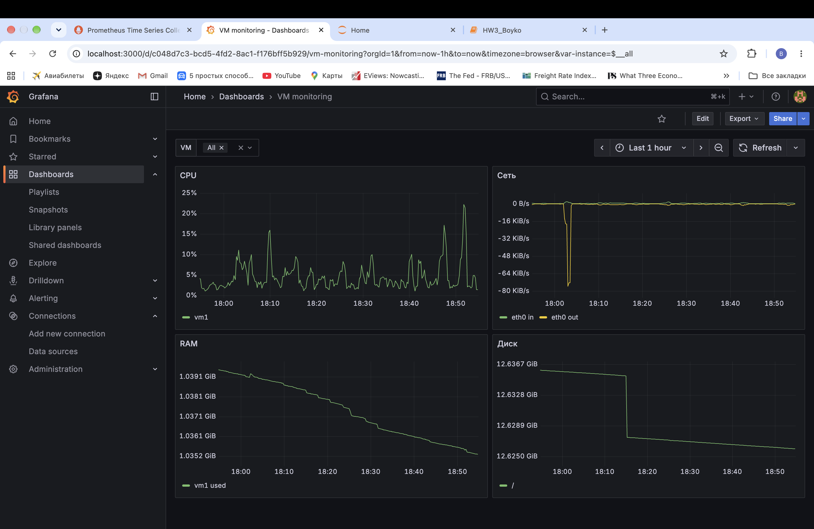

# ДЗ 3: мониторинг ВМ и Docker-образ для бэкенда

Полные логи выполнения: [`HW3_Boyko.ipynb`](HW3_Boyko.ipynb).

## Структура

```
.
├── monitoring/
│   ├── compose.yaml
│   ├── prometheus/prometheus.yml   
│   └── grafana/dashboard.json      
├── counter-backend/
│   ├── Dockerfile.single
│   ├── Dockerfile.multistage
│   ├── Dockerfile.nonroot
│   ├── .dockerignore
│   └── ...                         
├── screenshots/                    
├── HW3_Boyko.ipynb                 
└── README.md
```

## Задание 1. Node Exporter → Prometheus → Grafana

Стенд запускается командой `cd monitoring && docker compose up -d`.

- **Node Exporter** отдаёт метрики `node_*` на порту 9100. Порт закрыт для внешних адресов правилами iptables: доступ есть только с самого сервера и из Docker-сетей.
- **Prometheus**: в `prometheus.yml` добавлено задание `job_name: node` с целью `host.docker.internal:9100` и меткой `instance: vm1`. Цель в состоянии UP:

  

- **Grafana**: добавлен источник данных Prometheus (`http://prometheus:9090`), Save & test пройден:

  

- **Дашборд** создан вручную, переменная `instance` (`label_values(node_uname_info, instance)`), все запросы фильтруются по `{instance=~"$instance"}`:

  | Панель | Что показывает | Единицы |
  |---|---|---|
  | CPU | загрузка, всё кроме `idle` | % |
  | RAM | занятая память (MemTotal − MemAvailable) | байты |
  | Диск | свободное место на файловых системах | байты |
  | Сеть | входящий (`in`) и исходящий (`out`) трафик | байт/с |

  

JSON дашборда: [`monitoring/grafana/dashboard.json`](monitoring/grafana/dashboard.json).

## Задание 2. Три Dockerfile для counter-backend

Базовый образ: `python:3.11.6-slim-bookworm`. Команды сборки взяты из задания. Poetry зафиксирован на версии 1.x: в Poetry 2.x команда `poetry export` вынесена в отдельный плагин.

| Вариант | Устройство | Пользователь процесса |
|---|---|---|
| `Dockerfile.single` | одна стадия: сборка и запуск в одном образе | root |
| `Dockerfile.multistage` | стадия build (Poetry, export + wheel, build), в финальную стадию копируется только `dist` | root |
| `Dockerfile.nonroot` | как multistage + пользователь `app` (UID 1001) через `addgroup`/`adduser` и `USER` | app |

Каждый образ проверен запуском контейнера:

| Образ | GET /api/counter | POST /api/counter | docker exec … id |
|---|---|---|---|
| single | `{"count": 0}` 200 | `{"count": 1}` 201 | `uid=0(root)` |
| multistage | `{"count": 0}` 200 | `{"count": 1}` 201 | `uid=0(root)` |
| nonroot | `{"count": 0}` 200 | `{"count": 1}` 201 | `uid=1001(app)` |

### Сравнение размеров

| Образ | Размер | Сверх базового (195 MB) |
|---|---|---|
| counter-backend:single | 373 MB | +178 MB |
| counter-backend:multistage | 234 MB | +39 MB |
| counter-backend:nonroot | 234 MB | +39 MB |

В single остаются инструменты сборки: слой с Poetry и его зависимостями (80.7 MB) и слой с колёсами и окружением poetry (38 MB) + кэш pip. В multistage в финальный образ попадают только колёса из `dist` (2.5 MB), установленные пакеты (26.5 MB). nonroot отличается от multistage только слоем с созданием пользователя (~70 kB), поэтому размер тот же.
